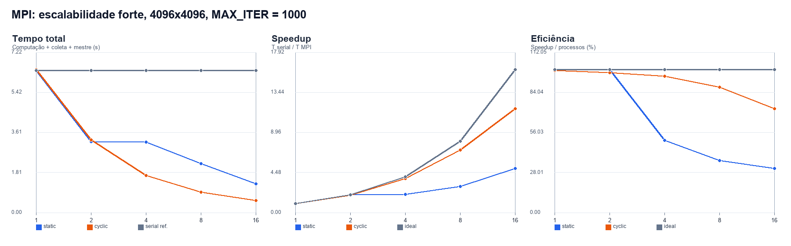
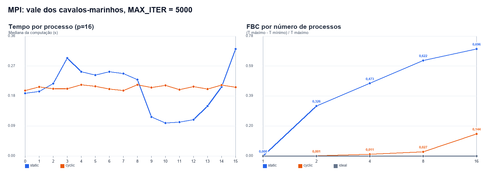
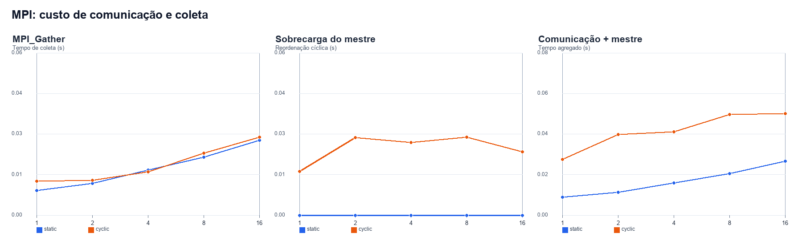
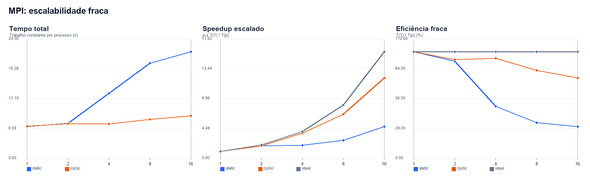
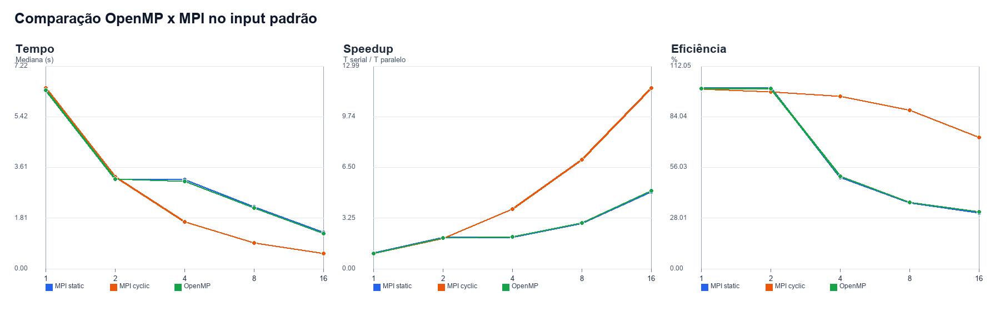

# Resultados MPI - Mandelbrot

## Escopo e metodologia

Foram avaliadas duas estratégias: `static`, com faixas contíguas de linhas, e `cyclic`, com linhas distribuídas ciclicamente. Cada configuração foi executada três vezes e as tabelas usam a mediana. O tempo total é `T_max de computação + MPI_Gather + sobrecarga do mestre`; escrita em disco foi medida separadamente e excluída das métricas de desempenho.

Ambiente registrado:

```text
Sistema operacional: Windows-11-10.0.26200-SP0
Processador: AMD64 Family 25 Model 80 Stepping 0, AuthenticAMD
Processadores logicos: 16
Compilador: MSVC 19.44.35228.0, /O2 /W4 /WX
MPI: Microsoft MPI 10.1.12498.18 (runtime e SDK)
Repeticoes por configuracao: 3
Processos: 1, 2, 4, 8, 16
Estrategias: static (faixas contiguas), cyclic (linhas ciclicas)
FBC: (T_max - T_min) / T_max; 0 representa equilibrio ideal
Tempo total: T_max de computacao + Gather + sobrecarga do mestre; escrita excluida
```

## Corretude

A matriz `int32_t` de cada configuração oficial do input padrão foi comparada byte a byte com a referência serial. Também foram verificadas as duas estratégias no vale dos cavalos-marinhos. O critério admite até 0,01% de pixels divergentes, com diferença máxima de uma iteração.

| Caso | Estratégia | Processos | Pixels diferentes | Diferença máxima | Status |
| --- | --- | --- | --- | --- | --- |
| standard | static | 1 | 0 | 0 | APPROVED_EXACT |
| standard | static | 2 | 0 | 0 | APPROVED_EXACT |
| standard | static | 4 | 0 | 0 | APPROVED_EXACT |
| standard | static | 8 | 0 | 0 | APPROVED_EXACT |
| standard | static | 16 | 0 | 0 | APPROVED_EXACT |
| standard | cyclic | 1 | 0 | 0 | APPROVED_EXACT |
| standard | cyclic | 2 | 0 | 0 | APPROVED_EXACT |
| standard | cyclic | 4 | 0 | 0 | APPROVED_EXACT |
| standard | cyclic | 8 | 0 | 0 | APPROVED_EXACT |
| standard | cyclic | 16 | 0 | 0 | APPROVED_EXACT |
| seahorse | static | 16 | 0 | 0 | APPROVED_EXACT |
| seahorse | cyclic | 16 | 0 | 0 | APPROVED_EXACT |

Resultado: **12/12 configurações aprovadas e 12/12 com igualdade exata**. O maior número de pixels divergentes foi 0, com diferença absoluta máxima 0.

## Escalabilidade forte - input padrão

Referência serial: mediana de 6.402 s para 4096×4096 e `MAX_ITER = 1000`.

### Distribuição estática

| Processos | T total (s) | Computação (s) | Gather (s) | Mestre (s) | Speedup | Eficiência |
| --- | --- | --- | --- | --- | --- | --- |
| 1 | 6.399 | 6.390 | 0.009 | 0.000 | 1.000x | 100.0% |
| 2 | 3.204 | 3.192 | 0.011 | 0.000 | 1.998x | 99.9% |
| 4 | 3.174 | 3.159 | 0.016 | 0.000 | 2.017x | 50.4% |
| 8 | 2.204 | 2.184 | 0.021 | 0.000 | 2.904x | 36.3% |
| 16 | 1.303 | 1.277 | 0.027 | 0.000 | 4.914x | 30.7% |

### Distribuição cíclica

| Processos | T total (s) | Computação (s) | Gather (s) | Mestre (s) | Speedup | Eficiência |
| --- | --- | --- | --- | --- | --- | --- |
| 1 | 6.448 | 6.418 | 0.012 | 0.016 | 0.993x | 99.3% |
| 2 | 3.273 | 3.233 | 0.012 | 0.028 | 1.956x | 97.8% |
| 4 | 1.678 | 1.636 | 0.015 | 0.026 | 3.816x | 95.4% |
| 8 | 0.914 | 0.864 | 0.022 | 0.028 | 7.004x | 87.5% |
| 16 | 0.552 | 0.502 | 0.028 | 0.023 | 11.600x | 72.5% |



Com 16 processos, a melhor estratégia foi `cyclic`, com 0.552 s, Speedup de 11.600x e Eficiência de 72.5%.

## Balanceamento de carga - vale dos cavalos-marinhos

Este experimento usa resolução 4096×4096, centro `(-0,743643887; 0,131825904)`, largura `3,0 × 10⁻³` e `MAX_ITER = 5000`, com 16 processos.

Foi adotada a definição usada em sala: `FBC = (T_max - T_min) / T_max`, onde `T_max` e `T_min` são o maior e o menor tempo de **computação** entre os processos MPI. Cada processo mede `T` com `MPI_Wtime()` após uma barreira inicial e encerra a medição imediatamente após calcular suas linhas, antes da barreira e do `MPI_Gather`. Portanto, `T` exclui coleta, reordenação no mestre e escrita em disco. O FBC é calculado em cada execução para 1, 2, 4, 8 e 16 processos, e a tabela apresenta a mediana das três repetições; 0 indica equilíbrio perfeito e valores próximos de 1 indicam forte desbalanceamento.

| Estratégia | Processos | T mín. (s) | T máx. (s) | FBC | Gather (s) | Mestre (s) | T total (s) |
| --- | --- | --- | --- | --- | --- | --- | --- |
| cyclic | 1 | 2.939803 | 2.939803 | 0.000000 | 0.013554 | 0.024083 | 2.977731 |
| cyclic | 2 | 1.476032 | 1.477402 | 0.000928 | 0.018213 | 0.033025 | 1.530109 |
| cyclic | 4 | 0.756443 | 0.764012 | 0.011205 | 0.023061 | 0.033162 | 0.818742 |
| cyclic | 8 | 0.389178 | 0.399824 | 0.026983 | 0.029546 | 0.034631 | 0.463633 |
| cyclic | 16 | 0.196327 | 0.229768 | 0.143594 | 0.026135 | 0.022894 | 0.281806 |
| static | 1 | 2.935853 | 2.935853 | 0.000000 | 0.018804 | 0.000000 | 2.951730 |
| static | 2 | 1.187991 | 1.761316 | 0.325527 | 0.019536 | 0.000000 | 1.780707 |
| static | 4 | 0.492904 | 0.938839 | 0.472899 | 0.024694 | 0.000000 | 0.964655 |
| static | 8 | 0.196120 | 0.512790 | 0.621915 | 0.031598 | 0.000000 | 0.543395 |
| static | 16 | 0.097802 | 0.322244 | 0.696498 | 0.031287 | 0.000000 | 0.353531 |

### Tempo de computação por processo com 16 processos

| Processo | Static (s) | Cyclic (s) |
| --- | --- | --- |
| 0 | 0.188784 | 0.197136 |
| 1 | 0.194584 | 0.208130 |
| 2 | 0.217519 | 0.202510 |
| 3 | 0.294983 | 0.202598 |
| 4 | 0.253198 | 0.213909 |
| 5 | 0.243069 | 0.209262 |
| 6 | 0.253796 | 0.201616 |
| 7 | 0.247924 | 0.196842 |
| 8 | 0.229874 | 0.214434 |
| 9 | 0.117140 | 0.206279 |
| 10 | 0.098814 | 0.212559 |
| 11 | 0.101528 | 0.199577 |
| 12 | 0.109475 | 0.209050 |
| 13 | 0.150434 | 0.201847 |
| 14 | 0.207979 | 0.213282 |
| 15 | 0.322244 | 0.207260 |



Com 16 processos, o menor FBC foi obtido por `cyclic` (0.143594). A distribuição cíclica tende a misturar linhas de custos diferentes, enquanto a estática agrupa regiões contíguas e pode concentrar pixels caros em poucos processos.

## Custo de comunicação

`MPI_Gather` foi medido isoladamente. Para `cyclic`, a reordenação das linhas no processo 0 aparece como sobrecarga do mestre; para `static`, essa etapa é nula. A escrita do binário ocorre depois das métricas e não compõe o tempo total.



O custo de coleta cresce com o volume e a quantidade de processos. A estratégia cíclica acrescenta uma passagem completa pela imagem no mestre para restaurar a ordem `row-major`. Com 16 processos, `Gather + mestre` consumiu 0.050 s (9.1% do total) em `cyclic`; em `static`, o `Gather` consumiu 0.027 s (2.0% do total).

## Escalabilidade fraca

O trabalho foi mantido em aproximadamente 4096² pixels por processo: 4096²/1, 5792²/2, 8192²/4, 11584²/8 e 16384²/16. Como o tamanho total do problema cresce com o número de processos, o speedup apresentado é o escalado: `S_escalado(p) = p × T(1) / T(p)`.

| Estratégia | Processos | Resolução | Pixels/processo | T total (s) | Speedup escalado | Eficiência fraca |
| --- | --- | --- | --- | --- | --- | --- |
| cyclic | 1 | 4096² | 16,777,216 | 6.513 | 1.000x | 100.0% |
| cyclic | 2 | 5792² | 16,773,632 | 7.041 | 1.850x | 92.5% |
| cyclic | 4 | 8192² | 16,777,216 | 6.958 | 3.744x | 93.6% |
| cyclic | 8 | 11584² | 16,773,632 | 7.903 | 6.593x | 82.4% |
| cyclic | 16 | 16384² | 16,777,216 | 8.658 | 12.037x | 75.2% |
| static | 1 | 4096² | 16,777,216 | 6.442 | 1.000x | 100.0% |
| static | 2 | 5792² | 16,773,632 | 7.093 | 1.817x | 90.8% |
| static | 4 | 8192² | 16,777,216 | 13.236 | 1.947x | 48.7% |
| static | 8 | 11584² | 16,773,632 | 19.414 | 2.655x | 33.2% |
| static | 16 | 16384² | 16,777,216 | 21.764 | 4.736x | 29.6% |



A eficiência fraca é `S_escalado(p) / p = T(1) / T(p)`. Quedas refletem comunicação, contenção de memória e a parcela serial da coleta/reordenação.

## Comparação com OpenMP

Os resultados OpenMP usados são da rodada de 29/10/2026, no mesmo computador, com três repetições e medianas.

| Recursos | OpenMP T (s) | MPI static T (s) | MPI cyclic T (s) | OpenMP Speedup | MPI static Speedup | MPI cyclic Speedup |
| --- | --- | --- | --- | --- | --- | --- |
| 1 | 6.369 | 6.399 | 6.448 | 0.997x | 1.000x | 0.993x |
| 2 | 3.189 | 3.204 | 3.273 | 1.990x | 1.998x | 1.956x |
| 4 | 3.110 | 3.174 | 1.678 | 2.041x | 2.017x | 3.816x |
| 8 | 2.169 | 2.204 | 0.914 | 2.926x | 2.904x | 7.004x |
| 16 | 1.266 | 1.303 | 0.552 | 5.015x | 4.914x | 11.600x |



OpenMP compartilha diretamente a matriz e evita a coleta de buffers privados, enquanto MPI paga por `Gather` e, no caso cíclico, pela reordenação. MPI, por outro lado, explicita custos relevantes para execução distribuída e pode escalar para múltiplos nós.

Com 16 recursos, OpenMP levou 1.266 s, MPI `static` 1.303 s e MPI `cyclic` 0.552 s. O MPI cíclico foi 2.29× mais rápido que o OpenMP medido, mas essa diferença não deve ser atribuída apenas a MPI: a curva forte do OpenMP usa distribuição estática contígua, cujo comportamento é muito próximo ao MPI `static`. O ganho principal vem da distribuição cíclica reduzir o desbalanceamento do Mandelbrot.

## Conclusão e relação com DGEMM

Ao contrário do DGEMM bloqueado, cujo custo por elemento é regular e previsível, Mandelbrot possui trabalho variável por pixel. Por isso, uma decomposição contígua pode ter FBC alto mesmo quando cada processo recebe o mesmo número de linhas. A distribuição cíclica melhora a mistura de carga, mas introduz reordenação no mestre. O experimento evidencia o compromisso entre balanceamento, comunicação e localidade que não aparece com a mesma intensidade no DGEMM regular.

## Arquivos

- `raw_timings.csv`: todas as execuções MPI e suas fases.
- `process_timings.csv`: tempos individuais de todos os processos.
- `correctness.csv`: comparação com a referência serial.
- `summary_strong_scaling.csv`: tempo, Speedup e Eficiência.
- `summary_weak_scaling.csv`: escalabilidade fraca.
- `summary_load_balance.csv` e `seahorse_process_times.csv`: FBC e tempos por processo.
- `comparison_openmp_mpi.csv`: comparação direta com OpenMP.
- `graficos/`: os cinco gráficos usados neste relatório.
