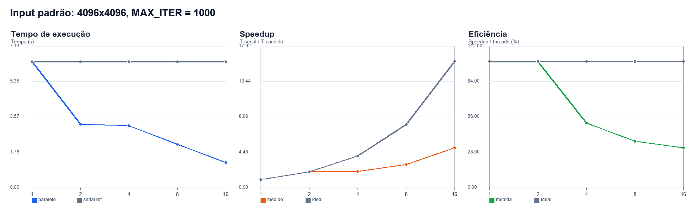
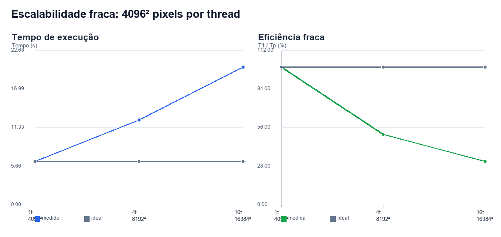
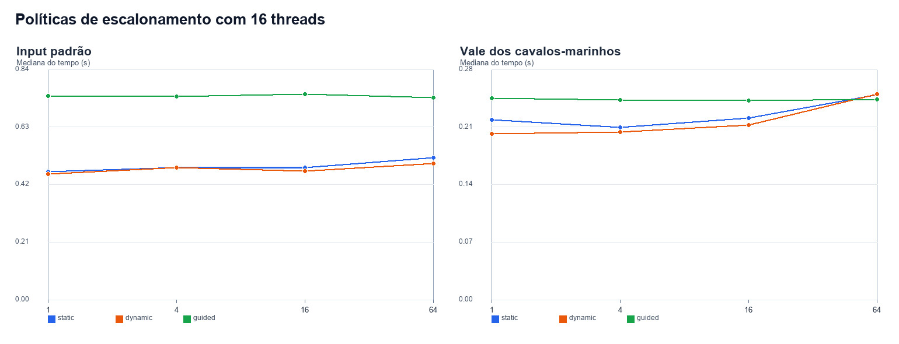
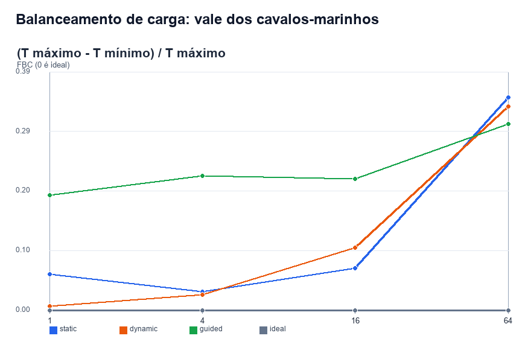

# Resultados OpenMP - Mandelbrot

## Escopo e método

Foram executadas 5 configurações de escalabilidade forte no input padrão (região completa, 4096x4096, `MAX_ITER = 1000`), 3 configurações de escalabilidade fraca e 12 combinações de política/chunk para cada input. Cada medição foi repetida três vezes; as tabelas usam a mediana. O relógio envolve somente o cálculo de escape-time e exclui leitura e escrita de arquivos.

Ambiente registrado na execução:

```text
Sistema operacional: Windows-11-10.0.26200-SP0
Processador: AMD Ryzen 7 5700
Processadores lógicos detectados: 16
Compilador: Microsoft C/C++ (cl.exe), otimização /O2
OpenMP: MSVC /openmp
Medições: 3 repetições por configuração; estatística principal = mediana
```

Políticas avaliadas: `static`, `dynamic` e `guided`; chunks: 1, 4, 16 e 64 linhas. A variação do número de threads no input padrão usa `static` sem chunk explícito, isto é, blocos contíguos de linhas.

## Corretude (Seção 5.5)

O critério do enunciado permite no máximo 0,01% de pixels divergentes (1.677 de 16.777.216), cada um com diferença máxima de uma iteração. Foram comparadas as matrizes de contagem da referência sequencial e da versão paralela em 29 configurações: 29/29 aprovadas; 29/29 com igualdade exata. O maior número observado de pixels diferentes foi 0, e a maior diferença absoluta observada foi 0.

Resultado: **todas as matrizes comparadas são idênticas**. Portanto, a implementação satisfaz o critério mais forte, sem usar a tolerância.

## Input padrão - tempo, Speedup e Eficiência

Fórmulas: `Speedup(p) = mediana(T_serial) / mediana(T_paralelo,p)` e `Eficiência(p) = Speedup(p) / p`.

| Threads | T serial (s) | T paralelo (s) | Speedup | Eficiência |
| --- | --- | --- | --- | --- |
| 1 | 6.347 | 6.369 | 0.997x | 99.7% |
| 2 | 6.347 | 3.189 | 1.990x | 99.5% |
| 4 | 6.347 | 3.110 | 2.041x | 51.0% |
| 8 | 6.347 | 2.169 | 2.926x | 36.6% |
| 16 | 6.347 | 1.266 | 5.015x | 31.3% |



A linha cinza do gráfico de tempo é a mediana da referência serial; a linha azul mostra a mediana paralela em cada contagem de threads.

## Escalabilidade fraca

Em cada configuração, a carga por thread foi mantida em 4096² pixels: 4096² com uma thread, 8192² com quatro e 16384² com 16. A política foi `static` sem chunk explícito. A eficiência fraca é `T(1 thread) / T(p threads)`; 100% representa tempo constante enquanto trabalho e recursos crescem juntos.

| Threads | Resolução | Pixels/thread | Mediana (s) | Eficiência fraca |
| --- | --- | --- | --- | --- |
| 1 | 4096 × 4096 | 16,777,216 | 6.374 | 100.0% |
| 4 | 8192 × 8192 | 16,777,216 | 12.445 | 51.2% |
| 16 | 16384 × 16384 | 16,777,216 | 20.224 | 31.5% |



## Políticas de escalonamento e chunk

Com o máximo de threads disponível na máquina, a melhor combinação no input padrão foi `dynamic, chunk=1` com mediana de 0.459 s. Ela equivale a Speedup de 13.816x e Eficiência de 86.3% frente à mediana serial. No vale dos cavalos-marinhos, a melhor combinação foi `dynamic, chunk=1` com mediana de 0.202 s (Speedup de 13.585x).

### Input padrão

| Política | Chunk | Mediana (s) | Média (s) | DP (s) |
| --- | --- | --- | --- | --- |
| static | 1 | 0.468 | 0.470 | 0.010 |
| static | 4 | 0.482 | 0.478 | 0.009 |
| static | 16 | 0.483 | 0.485 | 0.004 |
| static | 64 | 0.519 | 0.517 | 0.003 |
| dynamic | 1 | 0.459 | 0.459 | 0.001 |
| dynamic | 4 | 0.482 | 0.486 | 0.008 |
| dynamic | 16 | 0.469 | 0.470 | 0.006 |
| dynamic | 64 | 0.498 | 0.499 | 0.006 |
| guided | 1 | 0.745 | 0.752 | 0.020 |
| guided | 4 | 0.742 | 0.748 | 0.015 |
| guided | 16 | 0.751 | 0.748 | 0.009 |
| guided | 64 | 0.738 | 0.738 | 0.000 |

### Vale dos cavalos-marinhos (`MAX_ITER = 5000`)

| Política | Chunk | Mediana (s) | Média (s) | DP (s) |
| --- | --- | --- | --- | --- |
| static | 1 | 0.219 | 0.220 | 0.009 |
| static | 4 | 0.210 | 0.222 | 0.023 |
| static | 16 | 0.221 | 0.236 | 0.035 |
| static | 64 | 0.250 | 0.253 | 0.007 |
| dynamic | 1 | 0.202 | 0.202 | 0.001 |
| dynamic | 4 | 0.204 | 0.205 | 0.001 |
| dynamic | 16 | 0.213 | 0.213 | 0.002 |
| dynamic | 64 | 0.251 | 0.251 | 0.003 |
| guided | 1 | 0.246 | 0.245 | 0.003 |
| guided | 4 | 0.244 | 0.244 | 0.002 |
| guided | 16 | 0.243 | 0.243 | 0.001 |
| guided | 64 | 0.244 | 0.244 | 0.002 |



No input padrão, a combinação mais rápida foi `dynamic, chunk=1`. No vale dos cavalos-marinhos, `dynamic, chunk=1` teve a menor mediana. Portanto, o melhor índice de balanceamento não determina sozinho o menor tempo: a sobrecarga de agendamento e a localidade de memória também importam.

## Balanceamento de carga - vale dos cavalos-marinhos

Cada thread mede seu próprio tempo de cálculo antes da barreira de sincronização. O FBC usa `(T_max - T_min) / T_max`, a mesma fórmula da versão MPI; 0 representa distribuição ideal e valores próximos de 1 indicam forte desbalanceamento.

| Política | Chunk | T mín. (s) | T máx. (s) | T médio (s) | FBC |
| --- | --- | --- | --- | --- | --- |
| static | 1 | 0.197735 | 0.210120 | 0.202034 | 0.058941 |
| static | 4 | 0.196654 | 0.202814 | 0.199285 | 0.030376 |
| static | 16 | 0.194403 | 0.208893 | 0.200958 | 0.069364 |
| static | 64 | 0.162783 | 0.250418 | 0.201261 | 0.349955 |
| dynamic | 1 | 0.202531 | 0.203899 | 0.203199 | 0.006709 |
| dynamic | 4 | 0.198756 | 0.203870 | 0.201585 | 0.025083 |
| dynamic | 16 | 0.191277 | 0.213141 | 0.202398 | 0.102580 |
| dynamic | 64 | 0.165301 | 0.248598 | 0.199879 | 0.335068 |
| guided | 1 | 0.196102 | 0.241882 | 0.199852 | 0.189267 |
| guided | 4 | 0.198334 | 0.254417 | 0.205004 | 0.220436 |
| guided | 16 | 0.189645 | 0.241702 | 0.202250 | 0.215376 |
| guided | 64 | 0.167652 | 0.241519 | 0.198731 | 0.305844 |



## Arquivos desta pasta

- `raw_timings.csv`: todas as repetições cruas de escalabilidade forte e políticas.
- `weak_scaling.csv`: todas as repetições cruas de escalabilidade fraca.
- `summary_standard_scaling.csv`: tabelas de tempo, Speedup e Eficiência.
- `summary_weak_scaling.csv`: tabela de escalabilidade fraca e eficiência fraca.
- `summary_scheduling.csv`: médias, medianas e desvios por política e chunk.
- `correctness.csv`: comparação da matriz paralela com a referência sequencial.
- `seahorse_load_balance.csv`: tempos por thread e índice de desbalanceamento por política/chunk.
- `graficos/`: os quatro gráficos usados neste relatório.
